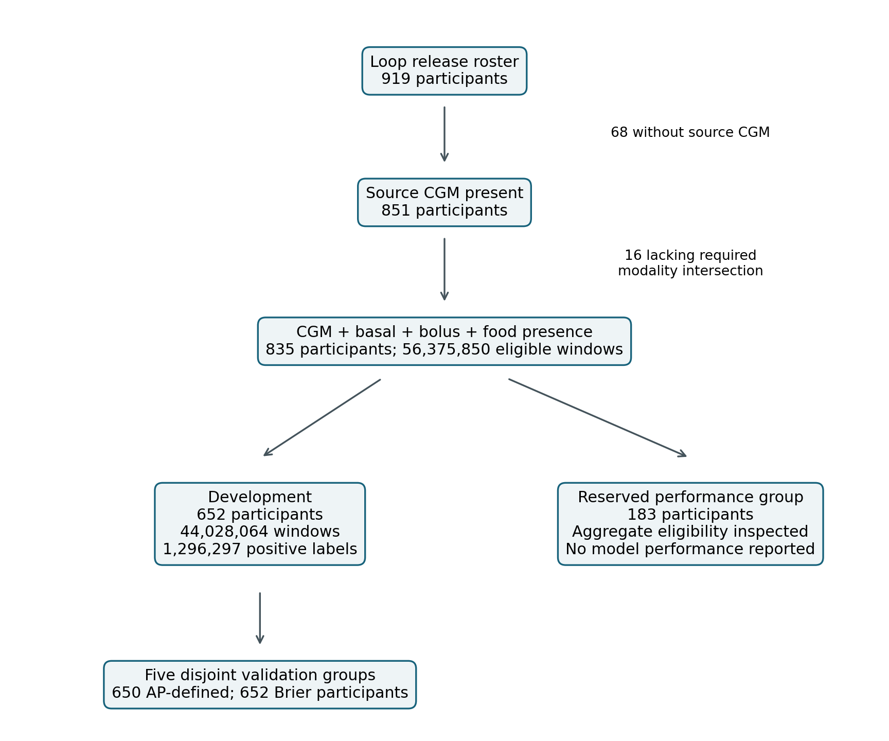
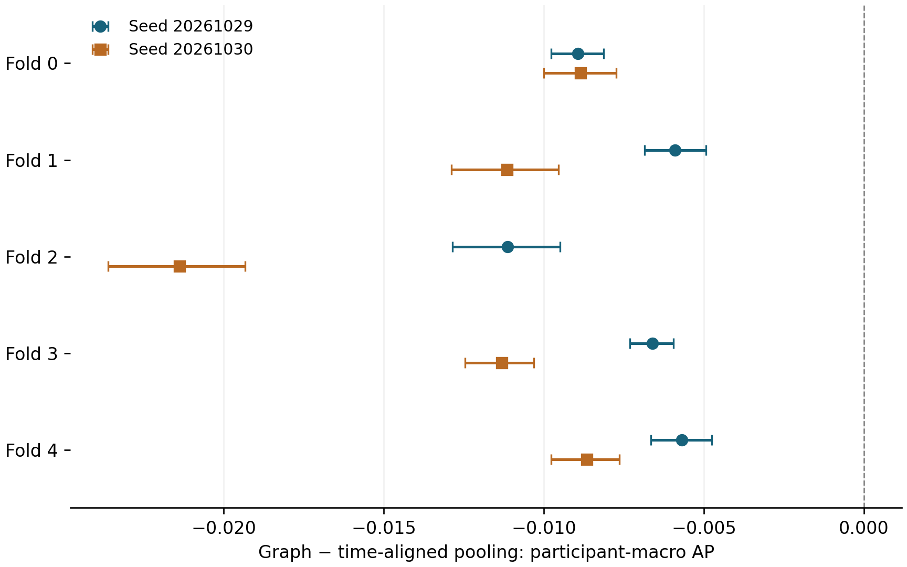

# Temporal Event Graphs and Time-Aligned Pooling for Hypoglycemia Prediction in Type 1 Diabetes: An Exploratory Patient-Disjoint Study

Authors: Pronab Chandra Roy; Lihui Liu

Affiliations: No institutional affiliations declared.

Correspondence contact: Pronab Chandra Roy [email address and corresponding-author responsibilities to be confirmed].

Working target: JAMIA, Research and Applications. Revised 8 November 2026; empirical evidence through 31 October 2026. Author declarations remain pending.

Abstract word count: 232. Conservative main-text word count: 3031 (including declaration and legend prose; excluding tables and references).

## Abstract

**Objective:** To compare a temporal event-to-CGM graph with non-graph representations for hypoglycemia prediction under shared information, timing, and parameter-count contracts.

**Materials and Methods:** This retrospective outpatient Loop automated-insulin-delivery analysis used 652 development participants and 44,028,064 windows, including 1,296,297 positive windows. The outcome was any observed continuous glucose monitoring (CGM) value below 70 mg/dL in the next 30 minutes after eligible non-low indices with complete future coverage. Inputs were 24 five-minute CGM slots and up to 64 recorded events. Graph and time-aligned pooling models each had 36,883 parameters and were evaluated across five patient-disjoint development folds and two seeds after two epochs. Paired participant-bootstrap intervals conditioned on saved predictions. Earlier sequence comparisons and a separate eight-epoch, single-fold CPU pair provided context.

**Results:** Pooling had higher participant-macro average precision (AP) in all ten two-epoch comparisons and lower macro-Brier in nine. After averaging each participant's paired differences across seeds, graph-minus-pooling AP was −0.009900 (95% interval −0.010477 to −0.009345; 650 participants), and Brier was +0.0001264 (+0.0001096 to +0.0001429; 652 participants). The eight-epoch AP difference was -0.000716. Earlier one-epoch comparisons favored the graph over a late-fusion sequence implementation.

**Discussion:** Pooling also changes the nonlinear CGM pathway, preventing attribution solely to message passing. Development selection, limited optimization and assumed immediate event availability constrain inference.

**Conclusion:** The tested graph did not outperform time-aligned pooling under the completed schedules. Reserved-holdout performance, independent explanation faithfulness and external graph validation remain unreported.

Keywords: type 1 diabetes; hypoglycemia prediction; continuous glucose monitoring; temporal event graph; patient-disjoint evaluation

## 1. Background and Significance

Continuous glucose monitoring (CGM) supports glucose-risk assessment in type 1 diabetes (T1D). Consensus recommendations distinguish glucose below 70 mg/dL (approximately 3.9 mmol/L) from the lower threshold of 54 mg/dL (approximately 3.0 mmol/L) [1]. Predicting a low reading within a future window is distinct from identifying a sustained or symptomatic episode. A prediction concerning the next 30 minutes may correspond to a crossing only five minutes away; the horizon alone does not establish useful warning time.

Insulin and meal records contextualize glucose trajectories, but their incremental predictive value requires direct comparison. Prior studies have evaluated insulin/carbohydrate inputs [2,3], glucose with physiological signals [4], and event-aware sequence or attention models [5,6,7,8,9,10,11,12,13,14]. Graph methods are also established: examples include pediatric de Bruijn forecasts [15], CGM visibility graphs compared with recurrent predictors [16], multimodal temporal graph risk models [17], semantic diabetes-KG proposals [18,19], and graph-recurrent glucose forecasting [20]. Earlier work modeled relations between diabetic event instances [21,22], while clinical temporal KGs integrate patient histories and medical ontologies [23,24]. Thus, context inclusion and graph construction are insufficient novelty claims.

Existing studies also overlap with the task and cohort design. MT-HypoNet reports Loop-based inter-patient forewarning with two-hour histories and a sustained-low target [25]. An October 2026 preprint compares sequence and multimodal glycemic-risk models using patient-disjoint outer folds and an any-future-CGM-low endpoint [26]; its described inputs differ from raw insulin/meal transactions. The supplementary source review records these distinctions, related study families and access limitations. It does not establish field-wide absence of an equivalent comparison.

A useful contribution is therefore an auditable assessment of a specific representation under increasingly stringent controls. Such comparisons must distinguish common event information and timing from differences in architecture, optimization and clinical interpretation. Predictive accuracy also does not establish explanation faithfulness or physiological validity [27,28,29].

## 2. Objective

We compared an event-to-CGM graph with a late-fusion sequence implementation and a later time-aligned pooling control, using the Loop public release [30,31]. The most stringent completed contrast is graph versus pooling. We report its results alongside the earlier comparisons and development history, following TRIPOD+AI reporting principles [32]. The intended users are researchers conducting offline representation studies; no deployment decision rule or treatment recommendation was evaluated.

## 3. Materials and Methods

### 3.1. Source, participants and study size

This secondary retrospective analysis used the local Loop release dated 31 January 2023. Its roster contained 919 participants; 851 had CGM records, and 835 had CGM, basal, bolus and nonempty food records somewhere in their released histories. Modality presence does not establish complete event capture in every prediction window. Of these participants, 652 were assigned to development and 183 reserved for later performance evaluation. Aggregate eligibility and label-coverage audits included the reserved group; no model performance for it is reported. Staged neural inputs excluded that group.

The original clinical publication studied 558 new Loop users in a U.S. outside-clinic cohort, with enrollment January–August 2019 and collection ending April 2020 [30]. Those dates and demographic summaries must not be substituted for the broader release-derived analytic cohort, whose exact observation-date bounds and demographic distributions remain unverified in the aggregate model evidence. Selection for recorded modalities and dense CGM may limit representativeness; demographic subgroup fairness was not evaluated.

Study size was determined by available eligible release data, without a documented prospective power calculation. The unit of generalization is the participant, not the overlapping window. Supplementary Table S1 distinguishes measured cohort quantities from unavailable characterization.

### 3.2. Canonicalization, prediction windows and outcome

Records were sorted by participant and UTC occurrence time. Exact re-exports collapsed using release-specific keys and deterministic source representatives. Calibration rows and conflicting same-time CGM measurements were excluded from the primary grid; distinct auxiliary variants were retained as recorded instances. Source glucose in mmol/L was converted by 18.0182 to mg/dL. The primary policy retained numeric values without asserting a device-specific validity cutoff. Range-filter retention audits were not alternate trained-model evaluations.

A logical five-minute grid used a development-selected one-second cadence tolerance. History comprised 24 nominal slots from t−115 minutes through t, with at least 22 observed slots, no more than two consecutive missing, and the final three readings observed at >=70 mg/dL. This recent-non-low rule is a modeling eligibility criterion. Missing glucose slots used zero payload plus an observation mask, without forward filling, backfilling or target interpolation.

The binary outcome was any of six observed future readings at nominal +5 through +30 minutes strictly below 70 mg/dL. All six readings were required for either class; incomplete futures, including those containing an observed low, were excluded. Exactly 70 was not low. Labels were generated automatically from source CGM, without subjective clinical adjudication. They describe sensor outcomes under recorded care, not untreated counterfactual risk, sustained episodes, symptoms or severe hypoglycemia. Coverage requirements select sufficiently observed periods.

### 3.3. Events and information-time contract

Models received the newest 64 event instances occurring in (t−120 minutes,t], ordered newest first. The cap followed a development truncation audit: 16 events truncated 39.272% of histories, whereas 64 truncated 17,720 windows (approximately 0.040%). Each 17-channel token encoded validity, modality, eight hashed subtype buckets, age, value, value-known and two provenance fields. Both provenance fields were zeroed for modeling. Subtype collisions are possible. Fixed scaling constants and exact token definitions are supplied in Supplementary Sections S2–S3.

Only conservatively validated normal-bolus components supplied known doses. Basal entries represented reported pump state rather than reconstructed insulin exposure; insulin-on-board and carbohydrate-on-board were not modeled. Unknown amounts retained explicit flags. Missing records were not interpreted as verified absence of eating or delivery.

Parent-upload linkage did not establish first-usable timestamps for the shared modalities. All comparisons therefore replayed occurrence times under assumed immediate availability. This is an optimistic retrospective information condition; event-reporting delay and real-time usability were not measured.

### 3.4. Model implementations

Each window defined an independent graph, without cross-patient hidden state. CGM slots and event tokens were embedded into 64 channels. Each valid event connected to the nearest observed CGM slot at or after its occurrence and no later than t. Three message experts consumed the event embedding, destination CGM embedding, elapsed time and modality. Generic routing averaged experts; typed routing selected one by modality. Count-normalized messages were added to CGM states before a 64-channel GRU and prediction head. The model had 36,883 parameters. These deterministic edges express temporal associations, not annotated physiological effects or an independently curated clinical ontology.

The aligned pooling control used identical event membership and destination bins, independently encoded events and normalized their sums by bin counts. Its 129→64 fusion layer, 64→2 branch-gating layer and 16 channel-gain parameters replaced the graph's 8,466-parameter expert bank, maintaining 36,883 total parameters. Shared input and count matching do not imply functional equivalence: pooling's learned fusion and gates also change the CGM-only pathway in event-empty bins. This comparison does not isolate the pairwise message operation causally.

The earlier 36,883-parameter sequence comparator encoded CGM and event histories separately and combined their recurrent states at the prediction head. Fusion position, widths and chronological processing differed from the graph. Complete layer definitions, nonlinearities and parameter accounting are given in Supplementary Section S3.

### 3.5. Development partitions, optimization and analysis history

Five development configurations each had mutually exclusive training, validation and internal development-test participants. Every development participant appeared once in validation across configurations (Table 1). Training sets overlapped, and the same folds were reused across seeds. The repository's “outer” terminology does not establish untouched nested cross-validation: architecture and control choices were informed by earlier development findings.

All current neural fits used AdamW, learning rate 0.0002, weight decay 0.0001, unweighted binary cross-entropy with logits, and batch size up to 4,096. Data streamed by participant/partition, rather than independently shuffled windows. Final-epoch scores were evaluated under each recorded schedule. Graph-versus-sequence fits used one epoch across five folds at seeds 20261003/20261004 on Apple MPS. The later graph-versus-pooling fits used two epochs across five folds at seeds 20261029/20261030. Source digests matched within every accepted pair; first-seed pooling sources varied between folds, while all second-seed folds shared one digest. A mismatched first-seed outer-4 graph run was excluded and rerun.

A separately declared eight-epoch CPU pair used outer-0 and seed 20261031. Its seed, fold and hardware differ from the two-seed aggregate; the contrast cannot identify an epoch effect. Equal parameter counts do not establish equal effective capacity, optimization effort or convergence. Dated local protocols and the supplementary planned-versus-executed register document amendments; no prospective registration identifier or complete unchanged prespecified analysis is established.

### 3.6. Metrics, pairing and uncertainty

The ranking metric was participant-macro average precision (AP), using grouped tied-score thresholds and stepwise precision–recall integration, version threshold-grouped-ap-v2. Earlier incorrect tied-score AP outputs were superseded. Two development participants had no positive labels, so AP used 650 people; Brier and coverage used all 652. Macro-Brier averages each participant's mean squared probability error equally; pooled Brier weights windows equally. Brier alone is not a complete calibration assessment.

Accepted pairs required matching participants, timestamps, labels, input/window identities, training membership, optimizer, budget and within-pair source digest. Ten thousand paired participant-bootstrap draws gave percentile 95% intervals for graph minus its comparator. For the two-seed pooling summary, differences were first averaged across seeds within participant, then participants were resampled. Supplementary Section S5 gives the estimand and bootstrap seeds. Intervals condition on saved fits and exclude refitting, selection, training-seed and independent-cohort uncertainty. No confirmatory multiplicity adjustment, equivalence margin or clinically meaningful difference threshold was specified.

### 3.7. Integrity and AI-assisted preparation

SHA-256 fingerprints bind inputs, splits, source versions and prediction identities. The manuscript build checks 21 central paired audits against 42 completed-run summaries and independent aggregate-recomputation receipts. It does not refit every model or repeat all historical inference. The evidence map and master record distinguish numerical verification, recovered archives and source-semantic assumptions.

AI-assisted tools supported coding, reference checking, auditing, execution orchestration across local and remote workflows, and writing. The human authors must confirm the tool/version/date details, verify the analysis, and accept responsibility. Three AI agents provided separate internal reporting, statistical and editorial reviews; these are not independent human or clinical peer review.

## 4. Results

### 4.1. Analytic cohort and coverage

The shared index contained 56,375,850 windows from 835 participants. Development contributed 44,028,064 windows and 1,296,297 positives (2.944%). Of these histories, 38,973,176 had all 24 CGM slots observed, 3,734,515 had one missing and 1,320,373 had two missing. Figure 1 shows cohort flow; Table 1 gives executed validation membership. Overlapping windows are repeated views of participant histories, not independent clinical episodes.

**Table 1. Development validation groups and outcome coverage.**

| Fold | Train | Validation / AP-defined | Internal test | Validation windows | Positive labels |
| --- | --- | --- | --- | --- | --- |
| 0 | 395 | 130 / 130 | 127 | 8,885,621 | 274,044 |
| 1 | 381 | 141 / 140 | 130 | 9,386,356 | 270,499 |
| 2 | 387 | 124 / 124 | 141 | 8,395,597 | 229,814 |
| 3 | 398 | 130 / 129 | 124 | 9,167,239 | 264,561 |
| 4 | 395 | 127 / 127 | 130 | 8,193,251 | 257,379 |

Older “outer-k” coverage groups may denote rotated internal development-test membership; this table follows the actual neural validation archives. Across the complete shared index, 20.222% of histories had no retained basal/bolus/food records, 43.772% had basal alone and 22.654% had all three. These are source-record coverage diagnostics, not complete clinical-event ascertainment. All eligible histories, including event-empty windows, remained in the comparison.

### 4.2. Graph versus time-aligned pooling

Pooling had higher AP in every two-epoch fold at both seeds (Tables 2–3; Figure 2). Macro-Brier favored pooling in four first-seed folds and all five second-seed folds. Each accepted pair had matching source and prediction identities; the between-fold first-seed source variation remains a limitation.

**Table 2. Graph versus time-aligned pooling, seed 20261029.**

| Fold | Participants | Graph / pooling AP | AP diff. (95% CI) | Graph / pooling Brier | Brier diff. (95% CI) |
| --- | --- | --- | --- | --- | --- |
| 0 | 130 | 0.498579 / 0.507520 | -0.008941 (-0.009766, -0.008136) | 0.020534 / 0.020652 | -0.000118 (-0.000177, -0.000060) |
| 1 | 141 | 0.487658 / 0.493560 | -0.005902 (-0.006855, -0.004940) | 0.019487 / 0.019313 | +0.000174 (+0.000146, +0.000204) |
| 2 | 124 | 0.473438 / 0.484578 | -0.011140 (-0.012849, -0.009501) | 0.019139 / 0.018987 | +0.000152 (+0.000118, +0.000188) |
| 3 | 130 | 0.498401 / 0.505002 | -0.006601 (-0.007319, -0.005948) | 0.019143 / 0.019065 | +0.000078 (+0.000039, +0.000113) |
| 4 | 127 | 0.505888 / 0.511579 | -0.005691 (-0.006656, -0.004758) | 0.020478 / 0.020367 | +0.000111 (+0.000090, +0.000131) |

**Table 3. Graph versus time-aligned pooling, seed 20261030.**

| Fold | Participants | Graph / pooling AP | AP diff. (95% CI) | Graph / pooling Brier | Brier diff. (95% CI) |
| --- | --- | --- | --- | --- | --- |
| 0 | 130 | 0.498684 / 0.507538 | -0.008854 (-0.010005, -0.007736) | 0.020588 / 0.020549 | +0.000039 (+0.000010, +0.000068) |
| 1 | 141 | 0.486196 / 0.497349 | -0.011153 (-0.012896, -0.009550) | 0.019484 / 0.019298 | +0.000186 (+0.000161, +0.000212) |
| 2 | 124 | 0.471794 / 0.493181 | -0.021387 (-0.023610, -0.019330) | 0.019203 / 0.018862 | +0.000340 (+0.000306, +0.000377) |
| 3 | 130 | 0.494227 / 0.505545 | -0.011318 (-0.012458, -0.010314) | 0.019222 / 0.019076 | +0.000146 (+0.000093, +0.000195) |
| 4 | 127 | 0.507687 / 0.516353 | -0.008666 (-0.009782, -0.007650) | 0.020452 / 0.020293 | +0.000158 (+0.000137, +0.000183) |

AP and Brier differences are graph minus pooling. Positive AP favors graph; negative Brier favors graph. Intervals resample participants conditional on fitted predictions.

Averaging paired differences over the two fixed seeds within participant gave AP −0.009900 (95% interval −0.010477 to −0.009345; 650 people) and macro-Brier +0.0001264 (+0.0001096 to +0.0001429; 652 people). Pooling led AP for 639 of 650 AP-defined people and Brier for 528 of 652. The repeated seeds did not increase the independent participant count.

In the separate eight-epoch pair, graph AP was 0.533263 versus pooling 0.533979, difference -0.000716 (-0.001317, -0.000106); macro-Brier was 0.019720 versus 0.019706, difference +0.000014 (+0.000001, +0.000028). The smaller gap is descriptive and cannot be assigned solely to schedule duration. The single fold/seed does not establish convergence or equivalence.

### 4.3. Earlier comparisons and diagnostic controls

The earlier one-epoch graph-versus-sequence study favored the graph on AP and macro-Brier in all ten seed-fold fits. Unweighted mean AP differences were +0.086532 at seed 20261003 and +0.086575 at seed 20261004. These descriptive fold means are different estimands from the participant-weighted two-seed pooling summary. A separate CUDA outer-0 pair reproduced the direction but not exact numerical results. Full foldwise values are in the numerical supplement.

Modality-typed routing had higher AP in only two of five folds at one seed; mean typed-minus-generic AP was −0.000476. Nearest-versus-second-nearest endpoint assignment favored nearest in eight of ten paired comparisons, with participant-summary AP difference +0.002097 and macro-Brier −0.0000773. Reassigning event ages had a much smaller original-pairing AP advantage (mean +0.000112) and mixed Brier directions. These perturbations assess model sensitivity, not clinical relation validity.

Earlier event-summary, additive-residual, CGM-history and event-disabled studies did not establish stable incremental event value. One corrected logistic model had 14 total features—two CGM plus 12 event variables—and lower AP than its CGM reference. Two graph event-disabled pairs had opposite directions under different seeds/schedules; disabling events also removes gradients to event modules. An explanation screen used deletion-based event selection and related deletion/retention evaluation on 518 windows, making the result selection-conditioned. Historical outcomes, corrections and caveats are retained in the master record and Supplementary Sections S6–S8.

## 5. Discussion

The apparent graph advantage depended on the comparator. The graph exceeded a parameter-count-matched late-fusion sequence implementation, yet time-aligned pooling performed better in every two-epoch AP comparison and in the separate eight-epoch pair. The informative result is the contrast between these implementations under shared recorded inputs and timing. It does not identify a general graph disadvantage, the effect of alignment alone, or the clinical value of the deterministic edges.

The pooling control changes both event integration and the nonlinear CGM pathway, including in event-empty bins. Consequently, its advantage cannot be attributed solely to removing graph messages. The sequence and pooling studies also differ in epoch count and architecture, precluding a factorial explanation of why the comparison changes. A stronger mechanistic test would preserve CGM processing and fusion while varying only the event-conditioned operation. A stronger predictive benchmark would also give CGM-only and event-aware models comparable tuning and sufficient training-side optimization.

Data quality is integral to this interpretation. Shared duplicate handling, eligibility and prediction identities reduce inconsistencies between models, but do not establish complete clinical-event capture or valid event availability. Manually entered meals may become usable after occurrence. Complete-future requirements select periods with dense sensor coverage, and the retained numeric policy does not validate all extremes. The results apply to the sampled release histories and the recorded treatment process.

Several limitations prevent stronger inference. Model design reused development findings; the study is exploratory and no reserved final-performance result is reported. Training groups overlap and seeds reuse the same people. Participant-bootstrap intervals condition on fixed fits and omit selection, refitting and seed uncertainty. Millions of windows cannot compensate for these dependencies. First-seed pooling sources vary across folds, although within-pair fingerprints match. The eight-epoch follow-up changes seed, fold and hardware context and does not establish convergence.

Population dates, demographic distributions and subgroup fairness are not characterized for the analytic cohort. The original study's recruitment or demographics cannot repair this gap. No external event or graph evaluation was completed: separate frozen CGM-logistic transfers to DCLP3/DCLP5 are limited diagnostic context, with unresolved source-clock and event semantics. Likewise, event-disabled results change direction and equal declared parameter counts do not ensure equal effective capacity.

Clinical usefulness remains unmeasured. AP and Brier do not supply an operating threshold, false-alert rate, sustained-episode sensitivity or warning lead time. Calibration curves, threshold selection, refractory rules and observable episode matching require separate analysis. The deletion screen does not independently validate explanations; no blinded clinician/patient usability assessment or prospective benefit was established. A documented negative comparison can guide model evaluation without implying clinical readiness or first-in-field novelty.

## 6. Conclusion

On shared Loop development windows, the tested graph exceeded one late-fusion sequence implementation but did not outperform time-aligned pooling under the completed schedules. The two-seed participant summary favored pooling on AP and macro-Brier. Architectural, optimization and development-selection limits restrict the finding to these implementations. The contribution is a reproducible comparative record, while isolated relation utility, independent explanation faithfulness and final clinical generalization remain unresolved.

## Declarations

**Ethics and consent:** The original prospective Loop study reported IRB approval and electronic consent [30]. [AUTHOR CONFIRMATION REQUIRED: applicable secondary-analysis approval, exemption or non-human-subject determination, institution/authority, reference identifier and consent applicability.] Original-study approval is not approval of this secondary analysis. No new approval is asserted.

**Data availability:** The source release is associated with the [Jaeb diabetes dataset collection](https://public.jaeb.org/datasets/diabetes) [31]. Reuse follows custodian terms. Aggregate evidence accompanies this paper; participant-level caches, identifiers, prediction shards and metadata-bearing checkpoints are excluded from the document bundle. [AUTHOR CONFIRMATION REQUIRED: permitted access statement, precise release citation and redistribution terms.]

**Protocol and registration:** Dated local protocols, amendments and the executed-analysis register accompany the manuscript. No prospective registration identifier is available for this secondary modeling study. Dated files do not establish unchanged prospective specification.

**Code availability:** Canonicalization, eligibility, model, metric and archive-checking code exists locally. [AUTHOR CONFIRMATION REQUIRED: public repository/archive identifier, immutable revision, code license and release environment.] Two raw basal source tables are currently missing locally; a fresh upstream reconstruction requires authorized reacquisition. Aggregate manuscript regeneration is a separate capability.

**Funding:** [AUTHOR CONFIRMATION REQUIRED: sources/grants or an accurate no-funding statement.]

**Competing interests:** [AUTHOR CONFIRMATION REQUIRED from each author.]

**Author contributions:** Pronab Chandra Roy and Lihui Liu are listed in the order supplied. [AUTHOR CONFIRMATION REQUIRED: CRediT roles, authorship eligibility/order approval and corresponding-author responsibility.]

**Patient and public involvement:** [AUTHOR CONFIRMATION REQUIRED: actual involvement or confirmed absence.]

**Acknowledgments and AI assistance:** AI tools assisted writing, reference review, coding, execution orchestration and evidence auditing across local and remote workflows. Analysis-related use is described in Methods. The authors must confirm tool/model versions and dates, verify the work and approve the disclosure and cover-letter statement. AI tools are not authors.

## References

[1] Battelino T, Danne T, Bergenstal RM, et al. Clinical Targets for Continuous Glucose Monitoring Data Interpretation: Recommendations From the International Consensus on Time in Range. Diabetes Care. 2019;42(8):1593–1603. [doi:10.2337/dci19-0028](https://doi.org/10.2337/dci19-0028).

[2] Dave D, DeSalvo DJ, Haridas B, et al. Feature-Based Machine Learning Model for Real-Time Hypoglycemia Prediction. Journal of Diabetes Science and Technology. 2021;15(4):842–855. [doi:10.1177/1932296820922622](https://doi.org/10.1177/1932296820922622). The paper compares CGM-based models with and without insulin/carbohydrate context, but pump context was available for a 19-person subset; the abstract/body discrepancy on the 30-minute incremental effect is unresolved.

[3] Zecchin C, Facchinetti A, Sparacino G, Cobelli C. How Much Is Short-Term Glucose Prediction in Type 1 Diabetes Improved by Adding Insulin Delivery and Meal Content Information to CGM Data? A Proof-of-Concept Study. Journal of Diabetes Science and Technology. 2016;10(5):1149–1160. [doi:10.1177/1932296816654161](https://doi.org/10.1177/1932296816654161).

[4] Cichosz SL, Frystyk J, Tarnow L, Fleischer J. Combining information of autonomic modulation and CGM measurements enables prediction and improves detection of spontaneous hypoglycemic events. Journal of Diabetes Science and Technology. 2015;9(1):132–137. [doi:10.1177/1932296814549830](https://doi.org/10.1177/1932296814549830).

[5] Rehman NU, Contreras I, Beneyto A, Vehi J. Explainable cluster-based learning for prediction of postprandial glycemic events and insulin dose optimization in type 1 diabetes. PLOS Digital Health. 2025;4(9):e0000996. [doi:10.1371/journal.pdig.0000996](https://doi.org/10.1371/journal.pdig.0000996).

[6] Gallardo-García C, Hernando ME, Subías D, Rigla M, García-Sáez G. Interpretable Multihorizon Glucose Forecasting for Assessing Nutritional Information Impact in Type 1 Diabetes Management: Model Development and Validation Study. JMIR AI. 2026;5:e105049. [doi:10.2196/105049](https://doi.org/10.2196/105049).

[7] Athanasiou M, Myropoulou N, Zarkogianni K, Nikita KS. Development of personalized interpretable multilevel prediction models for the risk assessment of hypoglycemia in Type 1 Diabetes. In: 2024 IEEE EMBC. [doi:10.1109/EMBC53108.2024.10781638](https://doi.org/10.1109/EMBC53108.2024.10781638).

[8] Ma N, Yu X, Yang T, Zhao Y, Li H. A hypoglycemia early alarm method for patients with type 1 diabetes based on multi-dimensional sequential pattern mining. Heliyon. 2022;8(11):e11372. [doi:10.1016/j.heliyon.2022.e11372](https://doi.org/10.1016/j.heliyon.2022.e11372).

[9] Zhu T, Uduku C, Li K, et al. Enhancing self-management in type 1 diabetes with wearables and deep learning. npj Digital Medicine. 2022;5:78. [doi:10.1038/s41746-022-00626-5](https://doi.org/10.1038/s41746-022-00626-5).

[10] Zheng X, Ji S, Wu C. Predicting Adverse Events for Patients with Type-1 Diabetes Via Self-Supervised Learning. In: IEEE International Conference on Acoustics, Speech and Signal Processing (ICASSP). 2024:1526–1530. [doi:10.1109/ICASSP48485.2024.10446832](https://doi.org/10.1109/ICASSP48485.2024.10446832). [Author-hosted paper](https://sijieji.github.io/pdf/Glucose_Prediction_ICASSP_2024.pdf).

[11] Sun X, Li H, Yu X. Future-aware blood glucose forecasting using knowledge distillation with transformer-based sequence-to-sequence models. Scientific Reports. 2026;16:11404. [doi:10.1038/s41598-026-41787-7](https://doi.org/10.1038/s41598-026-41787-7).

[12] Bertachi A, Viñals C, Biagi L, et al. Prediction of nocturnal hypoglycemia in adults with type 1 diabetes under multiple daily injections using continuous glucose monitoring and physical activity monitor. Sensors. 2020;20(6):1705. [doi:10.3390/s20061705](https://doi.org/10.3390/s20061705).

[13] Mosquera-Lopez C, Ramsey KL, Roquemen-Echeverri V, Jacobs PG. Modeling risk of hypoglycemia during and following physical activity in people with type 1 diabetes using explainable mixed-effects machine learning. Computers in Biology and Medicine. 2023;155:106670. [doi:10.1016/j.compbiomed.2023.106670](https://doi.org/10.1016/j.compbiomed.2023.106670).

[14] Yu X, Yang Z, Wang X, et al. A prior-knowledge-guided dynamic attention mechanism to predict nocturnal hypoglycemic events in type 1 diabetes. BMC Medical Informatics and Decision Making. 2024;24:378. [doi:10.1186/s12911-024-02761-3](https://doi.org/10.1186/s12911-024-02761-3).

[15] Cakiroglu MO, Kurban H, Aljihmani L, et al. A reinforcement learning approach to effective forecasting of pediatric hypoglycemia in diabetes I patients using an extended de Bruijn graph. Scientific Reports. 2024;14:31251. [doi:10.1038/s41598-024-82649-4](https://doi.org/10.1038/s41598-024-82649-4).

[16] Hüni F. Predicting Events of Hypoglycemia: A Comparison of Long Short-Term Memory and Graph Attention Network Based Approaches. Bachelor thesis, University of Bern; 2024. [Thesis PDF](https://prg.inf.unibe.ch/wp-content/uploads/2024/08/BA_FabianHuni.pdf). Related work: Hüni F, Garcia-Tirado J, Riesen K. LSTM Networks and Graph Neural Networks for Predicting Events of Hypoglycemia. In: Structural, Syntactic, and Statistical Pattern Recognition. Lecture Notes in Computer Science. Springer; 2025. pp. 52–61. [doi:10.1007/978-3-031-80507-3_6](https://doi.org/10.1007/978-3-031-80507-3_6).

[17] Sarwar MA, Maqsood S, Belousovienė E, Maskeliūnas R. GAT-BiGRU: explainable multi-task temporal graph learning for glucose forecasting, hypoglycemia risk, and counterfactual insulin adjustment. Journal of the American Medical Informatics Association. 2026;33(9):1713–1725. [doi:10.1093/jamia/ocag104](https://doi.org/10.1093/jamia/ocag104).

[18] Daniel Onwuchekwa JI, Weber C, Maleshkova M. Enhancing Hypoglycemia Prediction in Type 1 Diabetes through Semantic Knowledge Integration and Machine Learning Optimization. ESWC 2024 conference-hosted manuscript. [Conference full text](https://2024.eswc-conferences.org/wp-content/uploads/2024/05/77770363.pdf). The PDF title is used rather than its shorter running header, “Semantic AI for Hypoglycemia Prediction in T1D.”

[19] Sarani Rad F, Hendawi R, Yang X, Li J. Personalized Diabetes Management with Digital Twins: A Patient-Centric Knowledge Graph Approach. Journal of Personalized Medicine. 2024;14(4):359. [doi:10.3390/jpm14040359](https://doi.org/10.3390/jpm14040359).

[20] Piao C, Zhu T, Baldeweg SE, et al. GARNN: An interpretable graph attentive recurrent neural network for predicting blood glucose levels via multivariate time series. Neural Networks. 2025;185:107229. [doi:10.1016/j.neunet.2025.107229](https://doi.org/10.1016/j.neunet.2025.107229).

[21] Li Y, Ge T, Chen C. Data Stream Event Prediction Based on Timing Knowledge and State Transitions. Proceedings of the VLDB Endowment. 2020;13(10):1779–1792. [doi:10.14778/3401960.3401973](https://doi.org/10.14778/3401960.3401973).

[22] Acharya S, Lee BS. Incremental causal network construction over event streams. Information Sciences. 2014;261:32–51. [doi:10.1016/j.ins.2013.09.022](https://doi.org/10.1016/j.ins.2013.09.022).

[23] Chen J, Yin C, Wang Y, Zhang P. Predictive Modeling with Temporal Graphical Representation on Electronic Health Records. Proceedings of the Thirty-Third International Joint Conference on Artificial Intelligence (IJCAI-24). 2024:5763–5771. [doi:10.24963/ijcai.2024/637](https://doi.org/10.24963/ijcai.2024/637).

[24] Postiglione M, Bean D, Kraljevic Z, Dobson RJB, Moscato V. Predicting future disorders via temporal knowledge graphs and medical ontologies. IEEE Journal of Biomedical and Health Informatics. 2024;28(7):4238–4248. [doi:10.1109/JBHI.2024.3390419](https://doi.org/10.1109/JBHI.2024.3390419).

[25] Fang S, Zhang H, Hu D, et al. Glucose forecasting and hypoglycemia forewarning in type 1 and type 2 diabetes using deep learning. iScience. 2026;29(4):115294. [doi:10.1016/j.isci.2026.115294](https://doi.org/10.1016/j.isci.2026.115294).

[26] Khokhar PB, Gravino C, Palomba F. Reliability-Aware Short-Term Glycemic Risk Prediction Using an Anchor-Based Comparative Framework of Sequence, Multimodal, and State-Updating Digital-Twin Models. arXiv preprint arXiv:2610.36363. 2026. [arXiv](https://arxiv.org/abs/2610.36363).

[27] Calzavara A, Prendin F, Cappon G, Del Favero S, Facchinetti A. PhyNet: A Physiology-Constrained Monotonic Neural Network for Safe and Explainable Blood Glucose Forecasting. IEEE Transactions on Biomedical Engineering. 2026. [doi:10.1109/TBME.2026.3730324](https://doi.org/10.1109/TBME.2026.3730324).

[28] Ibrahim A, Banjar A, Harper S, Alarood A, Alsolami E. Forecasting accuracy is not enough: safety-oriented evaluation of neural digital twins prior to in-silico insulin and carbohydrate intervention in type 1 diabetes. Frontiers in Endocrinology. 2026;17:1958918. [doi:10.3389/fendo.2026.1958918](https://doi.org/10.3389/fendo.2026.1958918).

[29] Akrong GB, Appiah B, Commey D, et al. A comparative study of explainability methods for time-series forecasting of blood glucose levels. Discover Artificial Intelligence. 2026;6:604. [doi:10.1007/s44163-026-01328-7](https://doi.org/10.1007/s44163-026-01328-7).

[30] Lum JW, Bailey RJ, Barnes-Lomen V, et al. A Real-World Prospective Study of the Safety and Effectiveness of the Loop Open Source Automated Insulin Delivery System. Diabetes Technology & Therapeutics. 2021;23(5):367–375. [doi:10.1089/dia.2020.0535](https://doi.org/10.1089/dia.2020.0535).

[31] Jaeb Center for Health Research. Public datasets: diabetes. Loop study public dataset, release dated 31 January 2023, as identified in the local release. [Custodian dataset collection](https://public.jaeb.org/datasets/diabetes). Accessed 20 October 2026. The custodian's collection page was checked; a standalone release DOI was not established.

[32] Collins GS, Moons KGM, Dhiman P, et al. TRIPOD+AI statement: updated guidance for reporting clinical prediction models that use regression or machine learning methods. BMJ. 2024;385:e078378. [doi:10.1136/bmj-2023-078378](https://doi.org/10.1136/bmj-2023-078378).

## Figure legends

**Figure 1.** Release-to-development cohort flow. Modality presence is assessed over released histories, not completeness within every window. The reserved group had aggregate eligibility inspection but no reported model performance. Overlapping windows are not independent episodes.

Alt text: A flow diagram shows 919 release participants, 851 with source CGM, 835 with all required modality presences, then 652 development and 183 reserved participants. Development contains 44,028,064 windows and 650 AP-defined participants.

**Figure 2.** Graph-minus-time-aligned-pooling AP differences across five folds and two fixed seeds. Negative values favor pooling. Bars are 95% paired participant-bootstrap intervals conditional on each saved fit. Seeds reuse the same participant folds; no independent-cohort or seed-uncertainty estimate is shown.

Alt text: Ten fold-seed points and their participant-bootstrap intervals lie below zero on the graph-minus-pooling AP axis. Circular and square markers distinguish the two fixed seeds.
